# System Architecture — Medical Information Intelligence & Federated Research Platform

**Specification Coverage:** v23.2 through v40.0  
**Architecture Style:** Strict Modular Monolith (CPU-First, Zero-Trust, Random-Init Primary AI Track)

---

## 1. High-Level System Architecture

```mermaid
flowchart TD
    subgraph Interfaces["Interfaces Layer (medresearch_platform.interfaces)"]
        CLI["CLI (cli.py)"]
        API["REST API & OpenAPI 3.1 (api.py)"]
        WEB["Accessible Bilingual (EN/FR) Web Workspace"]
    end

    subgraph Security["Zero-Trust Security & Privacy Layer (medresearch_platform.security)"]
        AUTH["Argon2id Auth + HMAC Token RBAC/ABAC (auth.py)"]
        SAFE["Untrusted Document & Zip-Bomb/Prompt-Injection Guard (safety.py)"]
        PRIV["Bilingual PII Scrubber, Date-Shifter & Pseudonym Vault (privacy.py)"]
        AUD["Tamper-Evident SHA-256 Hash-Chained Audit Log (audit.py)"]
    end

    subgraph Workflows["Workflow Orchestration Layer (medresearch_platform.workflows)"]
        PIPE["MedicalResearchPlatformService (pipeline.py)"]
        REV["Human Review, IAA (Cohen's Kappa) & Adjudication (review.py)"]
    end

    subgraph Documents["Document Intelligence Layer (medresearch_platform.documents)"]
        PARSE["Native PDF / DOCX / TXT / PNG Parser & Sectioner (parsers.py)"]
        SYNTH["Synthetic Bilingual Corpus & Split Leakage Verifier (synthetic_generator.py)"]
    end

    subgraph AI["Primary Random-Init AI Research Track (medresearch_platform.ai)"]
        INIT["Deterministic Seed & SHA-256 Weight Provenance Verifier (random_init.py)"]
        OCR["Approach 1: CustomOCRConvNet-v1 + CER/WER (ocr_model.py)"]
        NLP["Approach 2: CustomMedicalNLPNet-v1 (Entity/Assertion/Temporality/Relation) (nlp_model.py)"]
        CV["Approach 3: CustomMedicalVisionNet-v1 (vision_multimodal.py)"]
        MM["Approach 4: CustomMultimodalFusionNet-v1 (Verified Pairs Only) (vision_multimodal.py)"]
        LONG["Approach 5: Longitudinal Timeline & Contradiction Graph (longitudinal.py)"]
        RET["Approach 6: Hybrid Lexical + Terminology + Neural Retrieval (longitudinal.py)"]
        TERM["Versioned Bilingual (EN/FR) Terminology Registry (terminology.py)"]
        EVAL["Calibration (ECE/Brier), Selective Risk, Fairness & FedProx (evaluation.py)"]
    end

    subgraph Storage["Data & Storage Layer (medresearch_platform.db)"]
        DB["DatabaseEngine: Canonical PostgreSQL 18 DDL + Local SQLite WAL (engine.py)"]
        OBJ["Immutable Content-Addressed Object Store (SHA-256 Originals & Checkpoints)"]
    end

    CLI --> PIPE
    API --> AUTH
    API --> PIPE
    API --> REV
    WEB --> API
    PIPE --> SAFE
    PIPE --> PRIV
    PIPE --> PARSE
    PIPE --> OCR
    PIPE --> NLP
    PIPE --> LONG
    PIPE --> RET
    PIPE --> EVAL
    PIPE --> AUD
    OCR --> INIT
    NLP --> INIT
    NLP --> TERM
    CV --> INIT
    MM --> INIT
    RET --> INIT
    PIPE --> DB
    PIPE --> OBJ
```

---

## 2. Domain Boundaries & Dependency Rules

1. **`medresearch_platform.config` & `diagnostics`**: Zero internal dependencies. Reads environment variables, enforces CPU thread/memory caps, and inspects hardware via `psutil`.
2. **`medresearch_platform.db`**: Manages schema migrations (`001_initial_schema.postgres.sql` and `001_initial_schema.sqlite.sql`), online backups, and checksum verification.
3. **`medresearch_platform.security`**: Enforces authentication, RBAC/ABAC permission checks (`medical_data:read`, `medical_data:write`, `annotation:review`, `training:execute`, `audit:read`), institution isolation, untrusted file validation, bilingual PII redaction, and SHA-256 hash-chained audit logs.
4. **`medresearch_platform.documents`**: Parses native PDF, DOCX, TXT, and image files into pages and clinical sections without mutating original files.
5. **`medresearch_platform.ai`**: Houses the six independent AI approaches, all initialized strictly from random weights (`he_normal`, `xavier_uniform`) with cryptographic weight-origin hashes (`initial_weights_sha256`).
6. **`medresearch_platform.workflows`**: Orchestrates end-to-end ingestion, human review/adjudication, and reproducible experiments.
7. **`medresearch_platform.interfaces`**: Exposes the Starlette ASGI REST API, OpenAPI 3.1 contract, accessible HTML workspace, and CLI.
