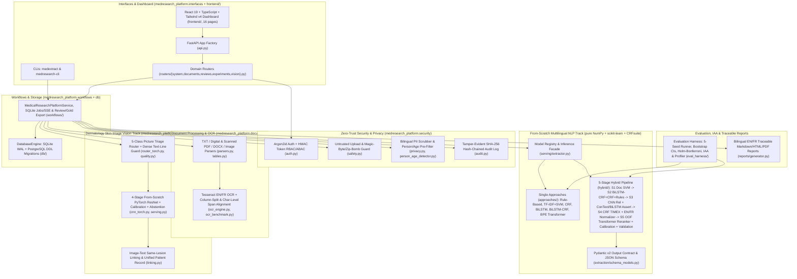

# System Architecture — Multilingual Medical Information Extraction AI (`medical_ai`)

**Version:** `0.2.0`  
**Architecture Style:** Strict Modular Monolith (CPU-First, Zero-Trust, Strictly From-Scratch Primary AI Track)  
**Target Hardware:** Intel CPU (`x86_64`), 32 GB RAM, CPU-only execution ([`ADR-0001`](DECISIONS/ADR-0001-modular-monolith-and-cpu-first-architecture.md), [`ADR-0009`](DECISIONS/ADR-0009-numpy-vs-pytorch.md), [`ADR-0010`](DECISIONS/ADR-0010-pytorch-cpu-for-vision.md))

---

## 1. High-Level System Architecture

---

## 2. Package Boundaries & Responsibilities

1. **`medresearch_platform.config` & `diagnostics`:** Environment configuration, CPU/memory inspection, and readiness diagnostics with zero internal dependencies.
2. **`medresearch_platform.data`:** Canonical annotation schema (`EntitySpan`, `RelationSpan`, `TimexSpan`, `AnnotatedDocument`), `SYNTH-MED-V3.1` generator, and SHA-256 locked split builder (`builder.py`).
3. **`medresearch_platform.documents`:** Native parsers for TXT, digital/scanned PDF (`pypdf`, `pdfplumber`, `pypdfium2`), DOCX (`python-docx`), and raster images, plus Tesseract (`eng` + `fra`) OCR with two-column layout segmentation and character-level reference span mapping.
4. **`medresearch_platform.approaches`:** Independently implemented single-paradigm EN/FR models trained strictly from random initialization in pure vectorized NumPy / `scikit-learn` / `sklearn-crfsuite`: `rule_based`, `classical_ml`, `classical_crf`, `bilstm`, `bilstm_crf`, and stacked multi-head BPE `transformer`, plus bilingual `context_negex.py` assertion/scope rules.
5. **`medresearch_platform.hybrid`:** Five-stage pipeline (`stage1_doc_understanding.py` through `stage5_integration.py`) with SHA-256 manifest persistence (`persistence.py`), out-of-fold Stage 5 Transformer reranking and temperature calibration, general EN/FR ISO-8601 TIMEX normalization, clinical consistency checks, and full ablation toggles.
6. **`medresearch_platform.extraction` & `reports`:** Single-source-of-truth Pydantic v2 JSON contract (`schema/medical_extraction.schema.json`) with source offsets, assertion/uncertainty flags, and traceable bilingual Markdown/HTML/PDF report generation.
7. **`medresearch_platform.eval_harness`:** Strict/lenient entity, assertion, relation, TIMEX, doc-type, and calibration metrics, 10,000-resample document-level bootstrap CIs, Holm-Bonferroni significance testing, error taxonomy, resource profiler, and double-annotation Inter-Annotator Agreement (`iaa.py`).
8. **`medresearch_platform.vision`:** Optional `.[vision]` PyTorch CPU dermatology track (`ADR-0010`) with 5-class picture triage router, illumination-invariant `detect_dense_text_lines` document safety guard, lesion-grouped splits, calibrated risk bands (dermoscopic-only served risk bands; clinical phone photos and TBP tiles abstain/suppress), and image-text linking.
9. **`medresearch_platform.security`:** Argon2id password hashing, HMAC Bearer tokens, RBAC/ABAC + institution isolation, untrusted file validation, bilingual PII redaction (`privacy.py`, `person_age_detector.py`), and hash-chained audit logs (`audit.py`).
10. **`medresearch_platform.workflows`, `db`, `serving`, `interfaces`:** SQLite WAL / PostgreSQL persistence, chunked background jobs with SSE progress, human review & `jsonl`/`brat` gold export, modular FastAPI routers (`interfaces/routers/`), and the React 19 + TypeScript + Tailwind dashboard (`frontend/`).
11. **`extras/legacy/`:** Frozen legacy prototypes isolated from the active package per [`ADR-0008`](DECISIONS/ADR-0008-scope-reduction-and-extras-isolation.md).
